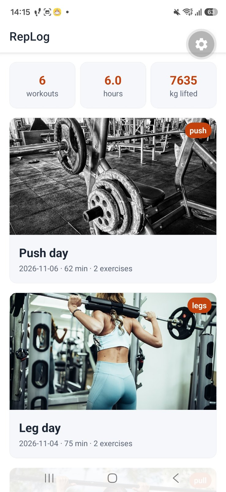
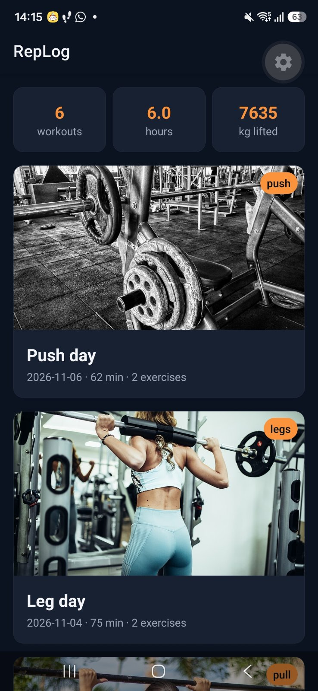

# RepLog

RepLog is a personal workout log where each session is saved with its exercises, sets and an optional progress photo taken with the phone camera. Users look back at their past sessions and see how their training changes over time.

## Screenshots

<p>
  
  
</p>

## Run it

```bash
npm install
npx expo start
```

Open the app with Expo Go (SDK 58) by scanning the QR code, or press `w` for the browser version.

## Features

- [x] First static screens from mock data (workout list with cards, workout details component)
- [x] Consistent theme (light and dark) and responsive layout
- [ ] Workout list with empty and loading states
- [ ] Workout details screen (`/workout/[id]`)
- [ ] Tabs (Workouts, Profile) and an add/edit modal
- [ ] Add, edit and delete a workout with form validation
- [ ] Global state and local copy of the workouts on the device
- [ ] Progress photo with the camera or gallery
- [ ] Sign-up, login and data in Supabase
- [ ] Android APK with icon and splash screen
